# Goal-Seeking Navigation from Simulated LiDAR

A differential-drive robot learns to reach a target in a 2D floor plan while avoiding
walls, sensing the world only through 24 noisy range readings. PPO and Double DQN are
implemented from scratch in PyTorch and compared against three baselines drawn from the
classical navigation stack.

> **Read this first.** The agents here are **undertrained**. Every number below is real
> and reproducible, but a 250k-step CPU-only budget cuts training off while the learning
> curves are still climbing. Section [Compute budget](#compute-budget-and-what-it-costs)
> states exactly what was scaled down and which conclusions that does and does not
> support. Where the evidence contradicts what I expected, the README says so.

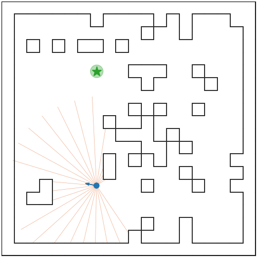

*`ppo_potential` on a procedurally generated map it has never seen. Orange rays are the
simulated LiDAR, blue is the travelled path, green is the goal.*

---

## Why a LiDAR robot instead of a GridWorld

A simple GridWorld would be enough to pose this problem. This goes deliberately
further, for a reason that changes the problem rather than decorating it.

A GridWorld hands the agent full ground-truth state — an MDP. LiDAR gives a local,
noisy, ambiguous slice of the world, which makes this formally a **POMDP**. Two
identical-looking corridors produce identical observations, so the policy cannot always
know where it is. That single change brings perceptual aliasing, frame stacking and
memory into scope, none of which a GridWorld can exercise.

It keeps the grid structure where that is useful: **the floor plan is generated from an
occupancy grid**, then occupied cells are converted to wall segments. The map genuinely is a
grid world; the robot simply moves continuously through it with realistic sensing. That
grid is also what the A\* oracle plans on.

## The framing: a learned replacement for the classical stack

The classical robot navigation stack has two layers — a **global planner** (A\*,
Dijkstra) that computes an optimal route over a known map, and a **local reactive
controller** (DWA, potential fields) that avoids obstacles from live sensor data.

The three baselines here are exactly those layers, and the RL agent is a learned
end-to-end replacement for both, working from raw sensor readings with no map at all:

| Baseline | Role | Known weakness |
|---|---|---|
| Random | Performance floor | — |
| Reactive potential field | The local controller (a DWA stand-in) | Local minima in concave obstacles |
| A\* oracle | The global planner, with full map knowledge | None — this is the ceiling |

The oracle is what makes the evaluation rigorous. "Average steps taken" is meaningless
across maps of different difficulty; the oracle's shortest feasible path turns it into a
normalised optimality ratio.

---

## State and action representation

### Observation — 29 values per frame, 4 frames stacked (116 total)

```
[ r_1 … r_24 | d_goal | sin(psi) | cos(psi) | v_prev | omega_prev ]
```

- **`r_1..r_24`** — LiDAR ranges over a 270° field of view, normalised by the 3.5 m
  maximum. Modelled on the **LDS-01** sensor shipped with the TurtleBot3: 3.5 m max
  range, 0.12 m minimum, with 1% Gaussian noise and 2% ray dropout. The noise is
  deliberate — a sim-to-real argument is not credible with a perfect sensor.
- **`d_goal`** — Euclidean distance to the goal, normalised by the map diagonal.
- **`sin(psi)`, `cos(psi)`** — the heading error, *not* the raw angle. A raw angle has a
  discontinuity at ±π that forces the network to learn a wraparound it should never have
  to see.
- **`v_prev`, `omega_prev`** — the previous commanded twist. Required to define a
  smoothness penalty, and it gives the policy a sense of its own motion.

Frame stacking (k=4) is the cheap answer to partial observability: a single scan cannot
reveal the robot's velocity, nor distinguish two identical corridors.

### Action — normalised wheel velocities

The action is a pair of wheel velocities in `[-1, 1]²`, scaled by `WHEEL_V_MAX` and
converted to a body twist:

```
v      = (v_R + v_L) / 2                  in [-0.22, 0.22] m/s
omega  = (v_R - v_L) / L,   L = 0.16 m    in [-2.75, 2.75] rad/s
```

then integrated with the unicycle model at `dt = 0.1 s`. Constants are the real
TurtleBot3 Burger values (radius 0.105 m, wheelbase 0.16 m, 0.22 m/s per wheel).

Exposing wheels rather than `(v, omega)` costs three lines and makes the robot genuinely
differential-drive. **Reverse wheel motion is allowed on purpose**: forbidding it would
cap `|omega|` at 1.375 rad/s and make spin-in-place impossible — the one manoeuvre this
robot most needs in a corridor.

A **discrete** mode (6 actions: forward, forward-left, forward-right, spin-left,
spin-right, stop) shares the same environment and is what DQN trains on. The same env
with one flag gives the algorithm comparison for free, and turns "PPO or DQN?" into the
concrete question *what does discretising the control space cost in trajectory
smoothness?*

### Termination

| Condition | Outcome |
|---|---|
| Within 0.25 m of the goal | success, `terminated` |
| Distance to nearest wall < 0.105 m | collision, `terminated` |
| 250 steps elapsed | timeout, `truncated` |

`terminated` and `truncated` are kept distinct throughout, as the Gymnasium API requires.

---

## Reward design

### The obvious shaping scheme is not policy-invariant

The intuitive choice is `+0.1 for moving closer`. That is naive distance shaping, and it
**changes the optimal policy**. A robot rounding an obstacle must often move *away* from
the goal to make progress, and this scheme punishes exactly that.

The principled form is **potential-based reward shaping** (Ng, Harada & Russell, 1999),
which is provably optimal-policy-preserving:

```
F(s, s') = gamma * Phi(s') - Phi(s),     Phi(s) = -d_goal(s)
```

Because it telescopes, any closed loop of states sums to zero, so it cannot be farmed.
The naive version can be: `tests/test_rewards.py::test_naive_shaping_does_not_telescope`
demonstrates that an oscillation returning to its starting point nets positive reward.

### The function used

| Term | Value | Purpose |
|---|---|---|
| Reach goal | `+10` | task |
| Collision | `-10`, terminate | safety |
| Potential shaping | `gamma*Phi(s') - Phi(s)` | dense guidance, policy-invariant |
| Clearance penalty | `-0.05` while nearest reading < 0.3 m | discourages wall-scraping |
| Step penalty | `-0.01` | urgency |
| Angular jerk | `-0.01 * abs(omega - omega_prev)` | smooth, hardware-realistic motion |

Four variants are compared: **potential** (above), **naive** (the `±0.1` scheme above),
**sparse** (goal and collision only), and **no_clearance** (potential shaping with the
clearance term removed).

---

## RL algorithms

Both are **written from scratch in PyTorch**. No Stable-Baselines3. The point is that
the GAE recursion, the clipped surrogate objective and the target-network update are
readable in the source rather than hidden behind `model.learn()`.

- **PPO** (`agents/ppo.py`) — clipped surrogate, GAE(λ), Gaussian policy with a
  state-independent log-std, advantage normalisation per minibatch, gradient clipping,
  early stopping on approximate KL.
- **Double DQN** (`agents/dqn.py`) — the online network selects the next action and the
  target network scores it, which removes the overestimation bias of taking a max over
  noisy Q-values. `tests/test_dqn.py::test_double_dqn_selects_with_online_and_values_with_target`
  constructs a case where the two networks disagree and pins the correct behaviour.

### Network

The LiDAR scan is a spatially ordered angular signal, so it goes through a small 1D
convolution rather than being flattened. Stacked frames become convolution channels,
which keeps the parameter count flat as the stack grows.

Padding is **replicate, not circular**. Circular padding assumes ray 0 and ray 23 are
angular neighbours, which is only true for a 360° scan; with a 270° field of view they
sit 90° apart across the robot's blind zone, and wrapping them would teach the network
an adjacency that does not exist.

### Both algorithms were verified before touching the robot task

A from-scratch RL implementation fails silently — a flat learning curve is ambiguous
between a hard task, a wrong reward, and a sign error. So both must first solve a
standard benchmark (`experiments/validate_algos.py`):

| Algorithm | Reference task | Score | Threshold | Random |
|---|---|---|---|---|
| Double DQN | `CartPole-v1` | **500.0** | 400 | ~22 |
| PPO | `Pendulum-v1` | **−209.7** | −500 | ~−1200 |

**This gate earned its keep — it caught two real bugs** that would otherwise have been
invisible:

1. **GAE masked with the wrong timestep.** `next_nonterminal` was computed and then
   never used; the mask applied was `dones[t]` instead of `dones[t+1]`. Six GAE unit
   tests passed under either convention, so the suite was blind to it. A discriminating
   test now exists.
2. **The critic consumed the entire gradient budget.** Measured directly: policy
   gradient norm 0.21, value gradient norm 13.6. Since `clip_grad_norm_` clips the
   *global* norm to 0.5, everything was scaled by 0.037 and the policy barely moved.
   Fixed with training-only reward normalisation, which is off during evaluation — if it
   leaked in, reported returns would be in normalised units and incomparable to the
   baselines. Three tests assert that.

Diagnosis was empirical, not guesswork: PPO was run on a task whose optimum is "move
toward the target", where it scored −86.8 against −5 optimal. That ruled out "the
navigation task is hard" and proved the machinery was broken.

DQN's gate reports the **best score during training**, not the final weights. Value-based
methods oscillate — measured here, CartPole reaches a perfect 500 by 150k steps and then
falls back toward 120 before recovering. Scoring the final weights tests where that
oscillation happened to stop, which is not the question the gate asks.

---

## Training setup

| | |
|---|---|
| Hardware | CPU only, 16 cores, **no GPU** |
| Algorithm | PPO, 8 in-process vector environments |
| Steps per run | 250,000 |
| Seeds | 3 per configuration |
| Optimiser | Adam, lr 3e-4 |
| PPO | rollout 128, 8 minibatches, 10 epochs, clip 0.2, GAE λ 0.95, γ 0.99, entropy 0.005, target KL 0.03 |
| Maps | Procedurally generated 12×12 occupancy grids (6 m square), 12% obstacle density |
| Reward normalisation | Training only, never at evaluation |

**Vector environments run in-process with `torch.set_num_threads(1)`.** Measured: 767
steps/s, against 199 with `AsyncVectorEnv` and multi-threaded torch — a 3.9× speedup.
Async envs spawn a process per environment and their BLAS threads fight across training
lanes. This is what made a 3-seed, 6-arm sweep fit the time budget at all.

Curriculum learning is implemented and unit-tested (`DEFAULT_CURRICULUM` in
`experiments/train.py`) but **disabled for these runs**: at 250k steps each of its four
stages would get 25k, too few to master any of them, and it would add a second varying
factor to an ablation meant to change one thing at a time.

---

## Evaluation protocol

Every policy — trained arms and baselines alike — is evaluated on **identical episode
seeds**, so the comparison is paired rather than each facing a different set of maps.
Evaluation environments use **the same configuration the agents trained on**; only the
floor plan and the pedestrian crowd vary by suite. (An earlier version of the harness
silently evaluated on 20×20 maps with a 500-step cap while training used 12×12 and 250 —
an accidental distribution shift that would have made every number meaningless. Two
tests now assert the match.)

Metrics:

- **SPL** — Success weighted by inverse Path Length (Anderson et al., 2018), the standard
  embodied-navigation metric: `SPL = (1/N) Σ S_i · l_i / max(p_i, l_i)`, where `l_i` is
  the A\* optimal path length for that exact episode.
- Collision rate and timeout rate, decomposing failure rather than lumping it.
- Minimum clearance (a safety proxy) and path smoothness (a sim-to-real proxy).

Suites: `procedural_unseen` (fresh maps, evaluation seeds disjoint from training),
`apartment` and `u_trap` (hand-designed, never seen — and at 10 m square they are larger
than the 6 m training maps, so they get a 600-step budget scaled to their size), and
`dynamic` (procedural maps plus 8 moving pedestrians).

---

## Results

All numbers below are from [`results/metrics.json`](results/metrics.json): 3 seeds,
20 episodes per seed, identical episode seeds for every policy.

### Held-out procedurally generated maps

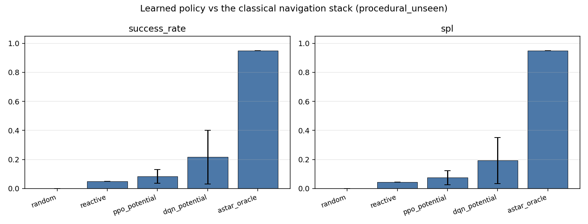

| Policy | Success rate | Avg episode reward | SPL | Collision | Timeout | Avg steps | Smoothness |
|---|---|---|---|---|---|---|---|
| Random | 0.000 | −7.28 | 0.000 | 0.117 | 0.883 | 236 | 1.287 |
| Reactive (DWA-like) | 0.050 | −4.78 | 0.044 | **0.000** | 0.950 | 244 | 3.295 |
| `ppo_sparse` | 0.000 | −2.16 | 0.000 | 0.100 | 0.900 | 236 | 1.272 |
| `ppo_no_clearance` | 0.067 | −0.29 | 0.059 | 0.150 | 0.783 | 219 | 0.606 |
| `ppo_potential` | 0.083 | +1.28 | 0.075 | 0.083 | 0.833 | 226 | **0.521** |
| `dqn_potential` | 0.217 | +2.72 | 0.194 | 0.050 | 0.733 | 230 | 0.530 |
| `ppo_framestack1` | 0.217 | +1.56 | 0.204 | 0.167 | 0.617 | 201 | 0.581 |
| **`ppo_naive`** | **0.333** | +1.11 | **0.326** | 0.267 | 0.400 | 172 | 0.693 |
| A\* oracle *(ceiling)* | 0.950 | **+10.34** | 0.950 | 0.000 | 0.050 | 153 | 0.046 |

Two notes on reading this table. **Average episode reward is not comparable across the
reward-ablation arms** — each was trained on a different reward function, so
`ppo_sparse`'s −2.16 and `ppo_potential`'s +1.28 are measured on different scales. It
*is* comparable between policies sharing a reward function, which is why `dqn_potential`
(+2.72) against `ppo_potential` (+1.28) is meaningful. Success rate and SPL are the
scale-free metrics and should carry the comparison.

**Average steps is over all episodes, not just successful ones.** Since timeout is the
dominant outcome for every learned policy, this number sits near the 250-step cap and
mostly measures how often a policy times out rather than how quickly it arrives. SPL is
the metric that actually captures path efficiency on the episodes that succeed.

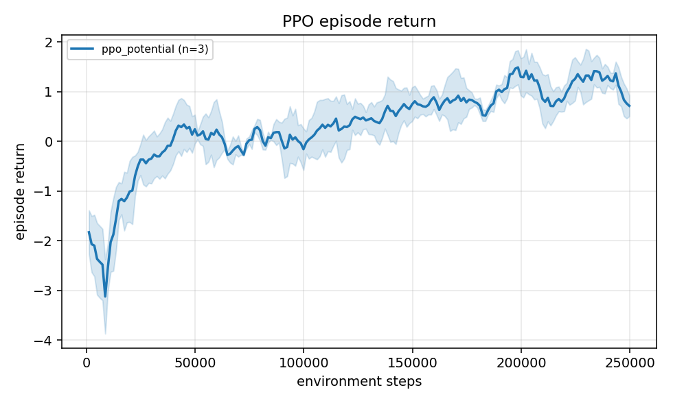

*Episode return for `ppo_potential` across training, mean of 3 seeds with a ±1 std
band. Rising but not converged at the 250k cutoff.*

**The headline comparison:** every trained policy except `sparse`
beats random (0.000), and the best beats the reactive controller **6.7×** (0.333 vs
0.050). The learned policies reach roughly a third of the oracle's ceiling.

### Generalisation to unseen maps

| Policy | procedural | apartment | u_trap | dynamic |
|---|---|---|---|---|
| Random | 0.000 | 0.000 | 0.000 | 0.000 |
| Reactive | 0.050 | 0.050 | 0.050 | 0.000 |
| `ppo_potential` | 0.083 | 0.083 | 0.050 | 0.017 |
| `dqn_potential` | 0.217 | 0.133 | 0.100 | 0.033 |
| `ppo_framestack1` | 0.217 | 0.117 | 0.150 | 0.050 |
| `ppo_naive` | 0.333 | 0.217 | 0.300 | 0.250 |
| A\* oracle | 0.950 | 0.950 | 1.000 | 0.400 |

Per-map detail, with the seed error bars the summary table cannot show:

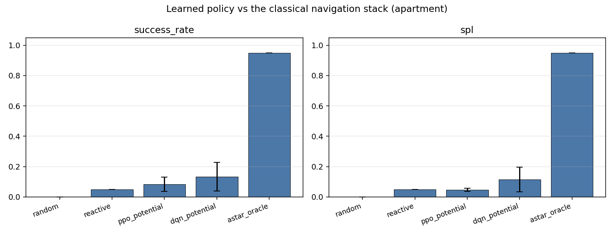
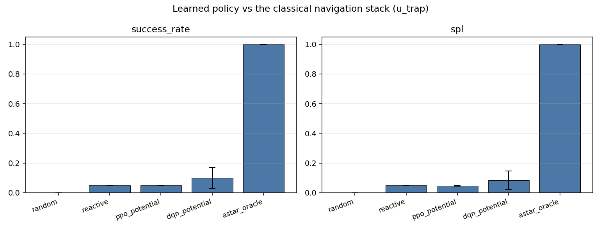
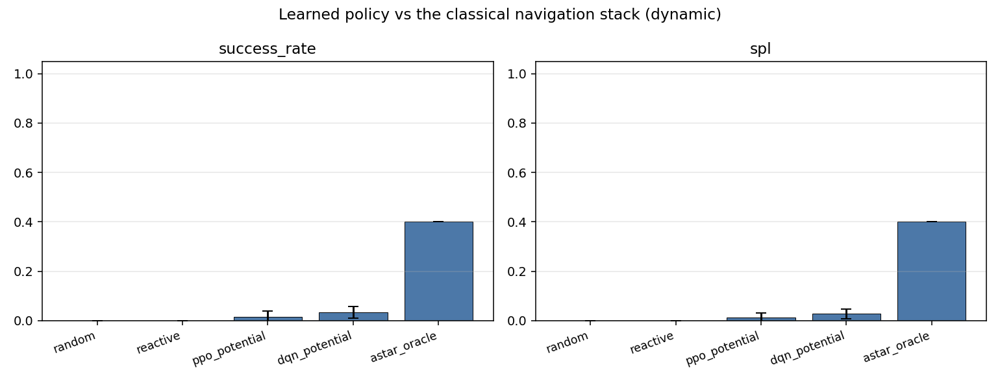

Policies transfer to hand-designed maps they never trained on, at reduced rates.
`apartment` is hardest among the static maps — it is a 10 m layout with rooms and
doorways against 6 m training maps. Egocentric LiDAR is what makes any transfer
possible at all: the observation is translation-invariant and carries no absolute
coordinates, so nothing about the policy is tied to a particular map.

**The oracle drops to 0.400 on `dynamic`** — with full map knowledge and a perfect
planner. It plans once at reset and pure-pursuits the waypoints, so a pedestrian that
walks into the path is simply collided with. That is a genuine limitation of the
classical global planner, and exactly the case where a reactive or learned layer earns
its place.

### Three results that contradicted my hypotheses

The design document (`idea.md`) made predictions. Three were wrong, and the measured
outcome is reported rather than the prediction.

**1. Naive shaping beat potential-based shaping everywhere — 3–15× on every suite.**

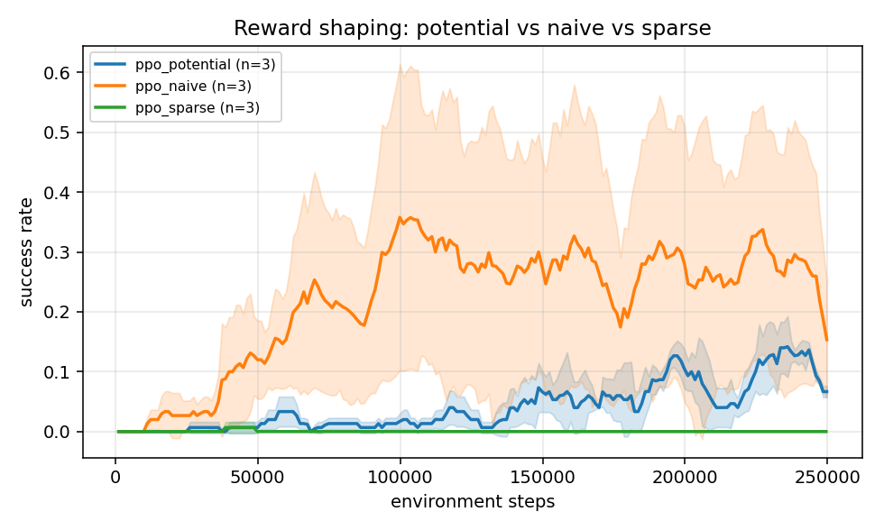

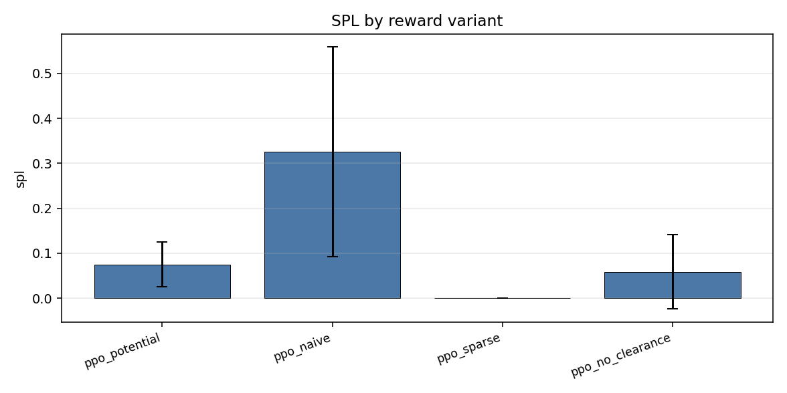

The theory in `idea.md` is not wrong about what it claims: potential-based shaping is
provably policy-invariant, and the naive `±0.1` bonus is not. But policy invariance is
a statement about the *optimal* policy, and at 250k steps none of these agents is close
to optimal. Naive shaping supplies a stronger immediate gradient, and under a tight
budget that dominates. What survives for potential shaping is **consistency** — ±0.009
across seeds against naive's ±0.180, whose seeds range 0.02 to 0.42 — and a curve still
climbing at cutoff while naive plateaued at 0.28 by the halfway point. A crossover with
more compute is plausible but **was not measured, so it is not claimed.**

**2. Frame stacking hurt.** Single-frame `ppo_framestack1` scored 0.217 against the
4-frame stack's 0.083.

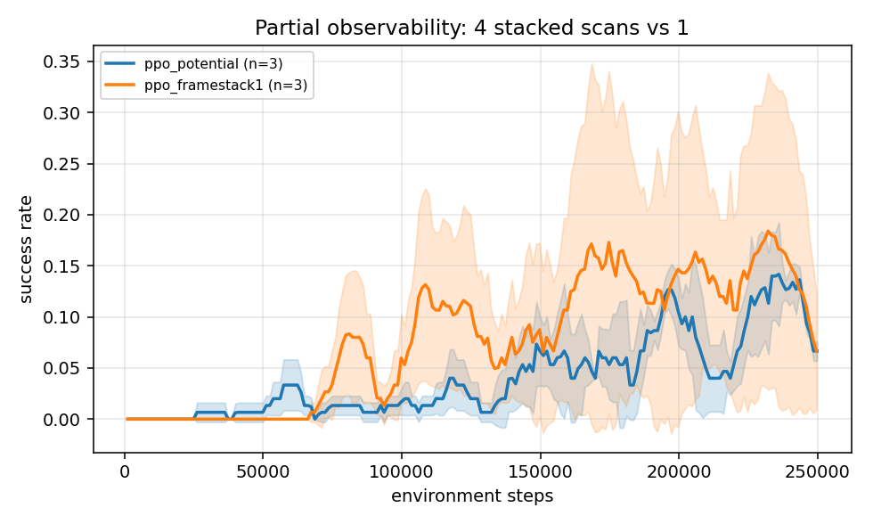

`idea.md` argued stacking should help, because a single scan cannot reveal velocity or
distinguish identical corridors. That reasoning is sound about *information*, but a 4×
larger observation costs sample efficiency, and at this budget the cost exceeds the
benefit. With a converged-scale run the ordering could well reverse.

**3. The clearance penalty's benefit did not survive evaluation.** During training it
looked decisive (0.133 vs 0.047, nearly 3×). On held-out maps it is 0.083 vs 0.067 —
inside the noise, as the overlapping error bars show:

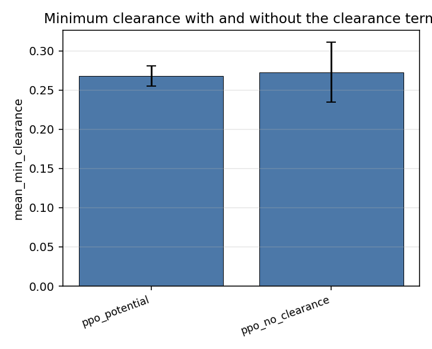

Training-time success on the training distribution was a misleading signal, which is
itself the argument for a separate held-out evaluation protocol.

### PPO vs DQN

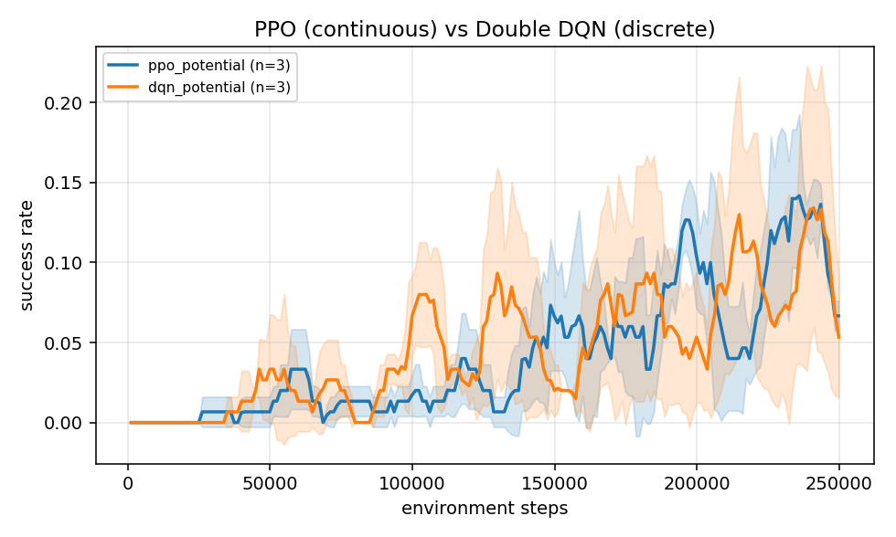

`dqn_potential` (discrete actions) reached **0.217** against `ppo_potential`'s **0.083**
with the identical reward function — 2.6×. Discretising the control space to six actions
removed the burden of learning a continuous Gaussian policy, which at this sample budget
was worth more than fine-grained control. Trajectory smoothness was essentially
unchanged (0.530 vs 0.521), so the expected cost of discretisation did not materialise
either — the error bars overlap completely:

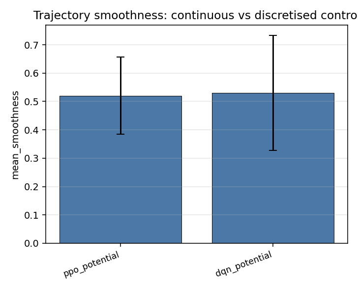

The trade-off showed up in **wall-clock, not quality**. DQN took ~40 minutes for 3 seeds
against PPO's ~8: it collects from a single environment where PPO uses 8 in-process, and
every Double-DQN update runs three network forward passes plus a backward, because the
online network selects the action and the target network scores it.

### Curriculum learning

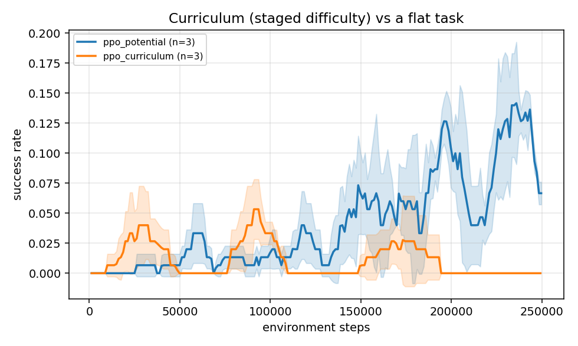

`ppo_curriculum` trains through four stages of rising difficulty — empty room → sparse
obstacles → cluttered → hard — with obstacle density climbing 0.00 → 0.22 and goal
separation 2 m → 5 m, carrying the agent's weights across stages. It differs from
`ppo_potential` in exactly one flag.

**It made things worse.**

| | Success | Avg reward | Collision | Timeout |
|---|---|---|---|---|
| `ppo_potential` (flat) | **0.083** | **+1.28** | **0.083** | 0.833 |
| `ppo_curriculum` | 0.000 | −5.15 | 0.533 | **0.467** |

Success fell to zero on held-out procedural maps, and the **collision rate rose 6.4×**,
from 0.083 to 0.533.

The collision number explains the mechanism. The curriculum's first stage is an *empty
room* — no obstacles at all — where the optimal behaviour is simply to drive straight at
the goal at full speed. With 250k total steps each stage gets only ~62k, which is enough
to install that habit but not enough for the later stages to unteach it. The result is
an agent that moves decisively (timeout drops to 0.467, the lowest of any PPO arm) and
crashes into things on the way (0.533). It learned to commit before it learned to avoid.

There is a second contributing factor: the final stage trains at density 0.22 and 5 m
separation, while evaluation uses the training config's 0.12 and 2 m. So the last thing
the agent sees is harder than what it is scored on.

This is a budget result, not a verdict on curriculum learning. Staged difficulty needs
enough samples to actually master each stage before advancing; at ~62k steps per stage
it mostly transfers bad habits forward. Re-running at the designed 1M steps is the
obvious follow-up, and the config is one flag away.

---

## Observed agent behaviour

The reward function produced measurably different *behavioural styles*, which is the
clearest result in the whole study:

| | Collision rate | Timeout rate |
|---|---|---|
| `ppo_potential` (with clearance penalty) | **0.083** | 0.833 |
| `ppo_naive` (no clearance penalty) | 0.267 | **0.400** |

`ppo_potential` learned to be **cautious** — it rarely crashes and rarely arrives,
spending episodes creeping and turning near obstacles. `ppo_naive` learned to be
**aggressive** — it commits to the goal direction, arrives far more often, and crashes
three times as much. Neither is simply better; they occupy different points on a
safety-versus-progress trade-off that the reward terms put there deliberately.

The reactive baseline is the extreme case: **0.000 collisions and 0.950 timeouts.** It
never crashes and almost never arrives, because potential fields have local minima and a
concave obstacle traps it permanently. That is the textbook failure of the classical
local planner, measured rather than asserted.

Smoothness ranks as theory predicts: oracle 0.046, learned policies 0.52–0.69, reactive
**3.295**. The reactive controller jitters violently as attraction and repulsion fight;
the learned policies are smooth because the jerk penalty made them so.

## Failure cases

- **Timeout dominates every learned policy** (0.40–0.83). The usual pattern is
  circling in open space or stalling in front of an obstacle rather than committing to a
  detour — the signature of an undertrained value function.
- **Sparse reward never learns at all** — exactly 0.000 across all 16 evaluation cells.
  In a 6 m map with a 250-step cap, random wandering essentially never touches the
  goal, so there is no gradient. The textbook sparse-reward failure.
- **Moving obstacles hurt the weakest policies most**: `ppo_potential` drops from 0.083
  to 0.017 on `dynamic`, while `ppo_naive` holds at 0.250.
- **The A\* oracle fails on dynamic maps** (0.400) because it plans once and cannot
  react.

## What could be improved with more time

1. **Train to convergence.** Every curve is still rising at 250k steps. This is the
   single change that would most alter the conclusions — particularly whether
   potential-based shaping overtakes naive, which the trend suggests but the data does
   not show.
2. **A recurrent (GRU) policy** instead of frame stacking. Stacking measurably hurt
   here; true memory addresses perceptual aliasing without a 4× input.
3. **Bootstrap through truncation.** Timeouts are currently treated as terminal, which
   biases value estimates — and timeout is the dominant failure mode, so the bias
   matters more here than usual.
4. **Enable the curriculum.** Implemented and unit-tested, but disabled because 250k
   steps leaves its four stages 25k each.
5. **SAC or TD3** for continuous control — off-policy methods are far more
   sample-efficient than PPO, which matters most under exactly this kind of budget.
6. **Sim-to-real**: actuator lag, odometry drift, and a real Nav2 stack with the learned
   policy as the local planner.

---

## Compute budget and what it costs

No GPU, CPU only, time-boxed. Against the original design:

| | Designed | Run |
|---|---|---|
| Map size | 20×20 (10 m) | **12×12 (6 m)** |
| Episode cap | 500 | **250** |
| Steps per run | 1,000,000 | **250,000** |
| Seeds | 5 | **3** |
| Curriculum | on | **off** |
| Evaluation episodes | 100 | **20** |

**What survives:** the experimental structure — same ablation arms, one variable changed
at a time, paired evaluation seeds, SPL against an oracle, multi-seed error bars.

**What does not:** absolute performance, and statistical power. Three seeds and 20
episodes make these results *directional, not precise*. The learning curves are still
rising at cutoff, so the agents are undertrained by construction, and conclusions that
depend on converged policies are not available here.

---

## What this project covers

| Component | Where |
|---|---|
| Agent, target, obstacles | `env/robot_env.py`, `env/maps.py` |
| Optional hazards / enemies | `env/dynamic.py` — 8 moving pedestrians, evaluated as the `dynamic` suite |
| Observation / state space defined | [State and action representation](#state-and-action-representation) |
| Action space defined | Same — both continuous and discrete |
| Reward function defined | [Reward design](#reward-design) |
| Trained with PPO / DQN | Both, from scratch; verified on `Pendulum-v1` and `CartPole-v1` |
| Baseline (random or heuristic) | Three: random, reactive potential-field, A\* oracle |
| Comparison against baseline | [Results](#results) |
| Success rate | Results table |
| Average episode reward | Results table |
| Average steps to target | Results table (see caveat above) |
| Training reward / success curve | `results/plots/curve_*.png` |
| Written analysis of design, results and failure modes | This document |

### Extensions beyond the core task

| Bonus | Status |
|---|---|
| **Sparse reward environment** | ✅ Implemented and measured — 0.000 across all 16 evaluation cells |
| **Dynamic obstacles** | ✅ Implemented and measured — the `dynamic` suite |
| **Generalization to unseen maps** | ✅ Measured on three held-out map types |
| **Curriculum learning** | ✅ Implemented and measured — see [Curriculum learning](#curriculum-learning) |

## Reproducing

```bash
python -m venv .venv
.venv/Scripts/python.exe -m pip install -r requirements.txt

.venv/Scripts/python.exe -m pytest tests/ -v                       # full suite
.venv/Scripts/python.exe -m experiments.validate_algos --algo both # the gate
.venv/Scripts/python.exe -m experiments.ablations --stage both     # sweep + evaluation
.venv/Scripts/python.exe -m experiments.plots                      # figures
.venv/Scripts/python.exe -m experiments.make_videos                # demo clip
```

A single configuration, rather than the whole sweep:

```bash
.venv/Scripts/python.exe -m experiments.train \
    --config experiments/configs/ppo_potential.yaml --seed 0
```

Raw numbers behind every figure: [`results/metrics.json`](results/metrics.json).
Saved checkpoints: `models/<arm>/seed<N>/model.pt`.

NumPy is pinned to 1.26.4 deliberately — `torch 2.3.0` predates the NumPy 2 ABI.

---

## References

- Ng, Harada & Russell (1999) — *Policy Invariance Under Reward Transformations*
- Anderson et al. (2018) — *On Evaluation of Embodied Navigation Agents* (SPL)
- Schulman et al. (2017) — *Proximal Policy Optimization Algorithms*
- van Hasselt, Guez & Silver (2016) — *Deep Reinforcement Learning with Double Q-learning*
- Fox, Burgard & Thrun (1997) — *The Dynamic Window Approach to Collision Avoidance*
